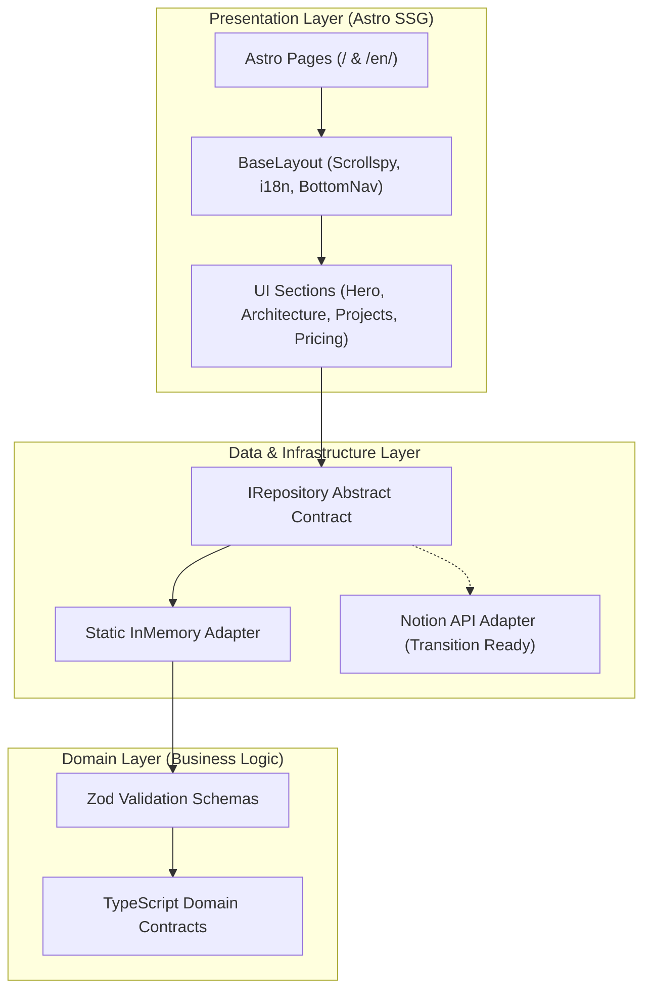

# Adi Novendra Putra — Software Engineering Portfolio

[](https://adino.my.id)
[](https://astro.build)
[](https://tailwindcss.com)
[](https://www.typescriptlang.org)

> Official personal engineering portfolio of **Adi Novendra Putra, S.Kom.** (`@novendra27`), Fullstack Developer and Software Engineer. Built with Astro in static site generation (SSG) mode, TypeScript domain validation, and an architectural blueprint design system.

[Live Production Platform](https://adino.my.id) · [English Edition](https://adino.my.id/en/) · [LLM Digest Specification](https://adino.my.id/llms.txt) · [LinkedIn Profile](https://www.linkedin.com/in/adi-novendra)

---

## [01 // CORE PROFICIENCIES]

Technical proficiencies mapped directly from verified project implementations and repository datasets:

| Domain Area | Technologies & Tools | Implementation Context in Repo |
| :--- | :--- | :--- |
| **Backend & Microservices** | Java (Spring Boot), Go, Laravel, PHP | REST APIs, business services, and database persistence |
| **Distributed Systems** | Apache Kafka, Event-Driven Architecture, Docker | Decoupled order and inventory messaging pipelines |
| **Algorithmic Optimization** | Python, Genetic Algorithms (GA) | Multi-constraint student team distribution engine |
| **Database Systems** | PostgreSQL, MySQL | Normalized schemas, indexing, and transactional data |
| **Frontend Architecture** | Astro v5 (SSG), React.js, Tailwind CSS, TypeScript | Static rendering, zero-JS hydration default, tokenized design |
| **Search & Discovery (SEO/AEO)** | Schema.org JSON-LD, LLMs.txt, XML Sitemaps | Structured metadata endpoints for search engines and AI crawlers |

---

## [02 // SYSTEM ARCHITECTURE & DESIGN]

The portfolio codebase separates domain contracts, data adapters, and presentation layers using the Repository Adapter Pattern.



### Architectural Details (Verified in Codebase)
* **Static Site Generation (SSG)**: Built using Astro in static mode (`output: "static"`). HTML pages are pre-rendered at build time with zero client-side JavaScript hydration overhead for content display.
* **Decoupled Data Layer**: The UI components consume data exclusively through repository contracts (`src/lib/repositories/contracts/`), backed by in-memory static adapters (`src/lib/repositories/static/`) with validation via Zod schemas (`src/domain/schemas/`).
* **Critical CSS Inlining**: Inlines critical stylesheets via `astro.config.mjs` (`build: { inlineStylesheets: 'always' }`) to eliminate render-blocking stylesheet requests.
* **Native Image Pipeline**: Uses `astro:assets` image processing to convert raw images to modern WebP with explicit dimension tags.
* **Bilingual Sub-Path Routing**: Native i18n configuration in Astro (`/` for Indonesian, `/en/` for English) with localized route switching.

---

## [03 // FEATURED ENGINEERING HIGHLIGHTS]

Verified software engineering projects cataloged in this repository (`src/data/projects.ts` and `src/data/project-links.ts`):

| Project | Architecture & Domain | Stack | Verified Link |
| :--- | :--- | :--- | :--- |
| **Event-Driven Store Management** | Decoupled pub/sub microservices for order processing and inventory deduplication | Java Spring Boot, Apache Kafka, Docker | [Producer Repo](https://github.com/novendra27/store-management-producer) · [Consumer Repo](https://github.com/novendra27/store-management-consumer) |
| **KKM Grouping Optimization Engine** | Heuristic multi-constraint student team distribution using Genetic Algorithms | Python (Server), Laravel (Web), MySQL | [Frontend Repo](https://github.com/novendra27/web-algen) · [Engine Repo](https://github.com/novendra27/server-algen) |
| **Pandanrejo Water Utility Billing** | Utility billing platform featuring multi-tier progressive tariffs and reporting | Laravel, MySQL, Alpine.js | [pamdesku.com](https://www.pamdesku.com/) |
| **Digital E-Book Marketplace** | E-commerce platform with catalog management and automated transaction flows | Laravel, MySQL, REST API | [GitHub Repo](https://github.com/novendra27/ebook-store) |
| **WatchTube Video Platform** | YouTube streaming web client with responsive interface | React.js, Tailwind CSS, REST API | [GitHub Repo](https://github.com/novendra27/watch-tube) · [Live Demo](https://nov-watch-tube.vercel.app/) |
| **VirtualR VR Landing Platform** | VR product landing page with modular component architecture | React.js, Tailwind CSS, Vite | [GitHub Repo](https://github.com/novendra27/virtualr) · [Live Demo](https://nov-virtualr.vercel.app/) |

> *Note: Projects under non-disclosure terms (such as DNDFX Expert Advisor and BLU Maturity Rating) are documented in the portfolio using sanitized architectural system topology flows without proprietary code or client data.*

---

## [04 // MACHINE READABILITY & AI AGENT DISCOVERY]

The portfolio exposes machine-readable endpoints following the [llmstxt.org](https://llmstxt.org) standard:

* [`/llms.txt`](https://adino.my.id/llms.txt): Core markdown summary and engineering index.
* [`/llms-id.txt`](https://adino.my.id/llms-id.txt): Indonesian language technical digest.
* [`/llms-full.txt`](https://adino.my.id/llms-full.txt): Comprehensive technical digest with project schemas, architecture blueprints, and contact channels.
* [`/robots.txt`](https://adino.my.id/robots.txt): Explicit permissions configured for search crawlers and AI bots (GPTBot, ClaudeBot, PerplexityBot, Google-Extended).

---

## [05 // DIRECTORY STRUCTURE]

```text
portfolio/
├── public/
│   ├── favicon.svg           # Minimal architectural favicon
│   ├── images/               # Production WebP image assets
│   └── robots.txt            # Search engine & AI crawler permissions
├── src/
│   ├── assets/               # Bundled visual assets & optimized images
│   ├── components/           # Architectural UI components
│   │   ├── sections/         # 8 Core content sections (Hero, Architecture, Projects, etc.)
│   │   └── seo/              # JSON-LD structured data graphs
│   ├── data/                 # Relational static datasets (11 entities)
│   ├── domain/               # Domain Layer (Zod validation schemas & types)
│   ├── i18n/                 # UI dictionary and translation helpers
│   ├── layouts/              # BaseLayout.astro (SEO, Header, BottomNav, Footer)
│   ├── lib/                  # Infrastructure & Data Layer (Repository pattern)
│   ├── pages/                # Astro file-based routes & dynamic text endpoints
│   └── styles/               # Global CSS & Tailwind directives
├── astro.config.mjs          # Astro configuration (Tailwind, Sitemap, i18n)
├── tailwind.config.mjs       # Centralized architectural design tokens
└── tsconfig.json             # TypeScript strict configuration with path aliases
```

---

## [06 // LOCAL DEVELOPMENT & REPRODUCTION]

### Prerequisites
* **Node.js**: `v20.x` or `v22.x`
* **npm**: `v10.x` or `v11.x`

### Setup & Run
```bash
# 1. Clone the repository
git clone https://github.com/novendra27/portfolio.git
cd portfolio

# 2. Install dependencies
npm install

# 3. Start local development server
npm run dev
```

Local development runs at `http://localhost:4321/` (Indonesian default) and `http://localhost:4321/en/` (English).

### Verification & Production Build
```bash
# Type check with Astro diagnostic tools
npm run check

# Compile production static distribution
npm run build

# Preview production build locally
npm run preview
```

---

## [07 // DEPLOYMENT PIPELINE]

Configured for static deployment on **Vercel** with continuous deployment from GitHub:
1. **Framework Preset**: Astro
2. **Build Command**: `npm run build`
3. **Output Directory**: `dist`
4. **Production Domain**: `https://adino.my.id`

---

## [08 // CONTACT & VERIFIED CHANNELS]

* **LinkedIn**: [linkedin.com/in/adi-novendra](https://www.linkedin.com/in/adi-novendra)
* **GitHub**: [@novendra27](https://github.com/novendra27)
* **Email**: [adi.novendra.p@gmail.com](mailto:adi.novendra.p@gmail.com)
* **WhatsApp**: [+62 899-3580-311](https://wa.me/628993580311)

---

## [09 // COPYRIGHT]

Copyright © Adi Novendra Putra. All rights reserved.  
Published for portfolio demonstration and technical recruitment review.
